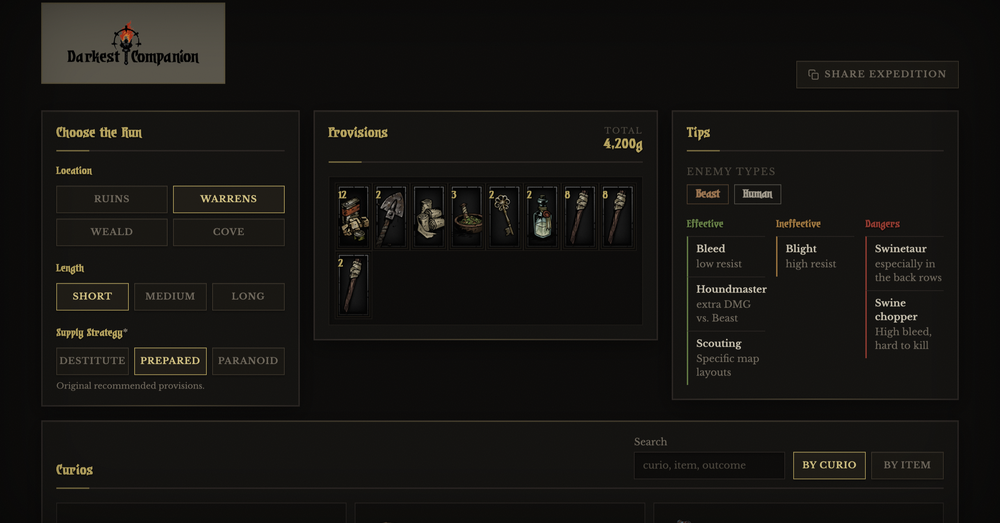
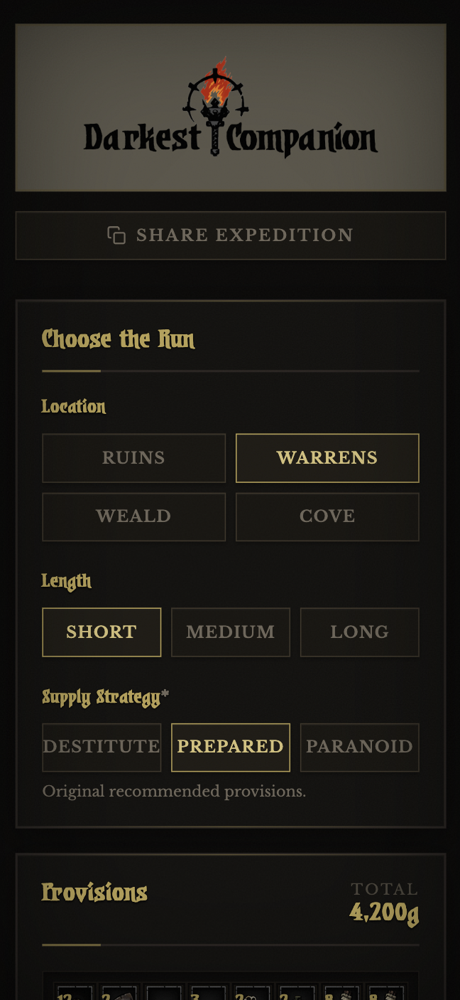

# Darkest Companion

A concise Darkest Dungeon companion for planning expeditions: provisions, curios, location tips, and shareable run state.

| Desktop | Mobile |
| --- | --- |
|  |  |

## Features

- Provision recommendations by location, dungeon length, and supply strategy.
- Curio lookup by curio or by item, with searchable outcomes.
- Location tips for enemy types, effective supplies, weak picks, and hazards.
- Shareable URLs that preserve the selected run setup and filters.

## Stack

- SvelteKit 2
- Svelte 5
- Vite
- Tailwind CSS 4
- Vitest

## Requirements

- Node.js 24, matching the GitHub Pages workflow.
- npm

## Development

```bash
npm install
npm run dev
```

## Scripts

- `npm run dev` starts the local dev server.
- `npm run check` runs Svelte and TypeScript checks.
- `npm test` runs the Vitest suite.
- `npm run build` creates the static production build.
- `npm run preview` serves the production build locally.

## Deployment

Pushes to `main` build and deploy the static site to GitHub Pages through `.github/workflows/deploy-github-pages.yml`.

## Optional audience measurement

Analytics is disabled by default. Before activation, the owner must confirm the applicable consent requirements, PostHog project retention, the separate project and region, and update the [privacy notice](src/routes/privacy/+page.svelte). Cookieless mode alone does not establish an exemption. Enable cookieless tracking in the PostHog project; keep autocapture, heatmaps, web vitals, replay, surveys and error capture off. Validate ingestion and the deployed network payload and storage in an approved test before collecting data.

Set all three build-time variables in GitHub Actions repository variables only after approval:

- `VITE_POSTHOG_PROJECT_TOKEN`: the public browser project token, never a personal API key.
- `VITE_POSTHOG_HOST`: matching HTTPS regional ingestion origin, for example `https://eu.i.posthog.com` for an EU project.
- `VITE_POSTHOG_SITE_ORIGIN`: exact approved HTTPS site origin, without a trailing slash or path.

The app also requires the runtime path to match its configured `BASE_PATH`. Missing or invalid configuration disables analytics. Remove the token variable and rebuild to disable it. These variables are public in the built site. The workflow does not set them itself.

Events are `$pageview` (fixed expedition or team-compositions URL), `expedition_filter_changed` (`filter`: location, length or risk; `value`: predefined choice), `curio_view_changed` (`view`), `team_hero_filter_changed` (`hero`, including `all`), and `expedition_shared` (no action properties). Search input, query strings, URL fragments and raw referrers are not event properties. The site sends no HTTP referrer. Provider-side IP and user-agent processing still applies. Unique visitor numbers are daily estimates, not deduplicated monthly people. See the [privacy notice](src/routes/privacy/+page.svelte).

## Credits

Game content, images, and materials are trademarks and copyrights of Red Hook Studios, creators of Darkest Dungeon.
